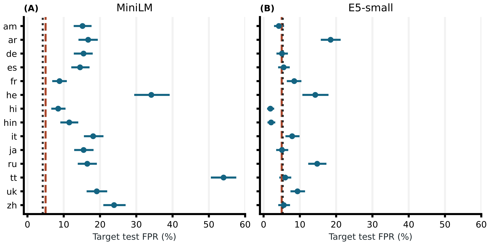
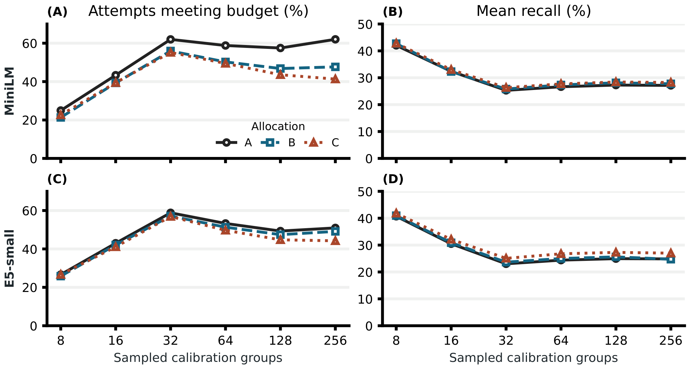

# When English Thresholds Travel: Recall Gaps and False-Positive Rates in Multilingual Text Classification

Ahsan Habib Shihab, Ayaulym Baidulla, Madina Mansurova, Amir Mosavi, Assel Ospan and Talshyn Sarsembayeva

A decision threshold chosen on English examples depends on which examples were available for calibration. When a classifier misses more topic-positive sentences in another language, would the same gap persist if a different English sample had set the threshold?

The manuscript examines this question on matched SIB-200 translations and studies false alarms on the separate TextDetox collections. This repository accompanies the **matched SIB-200 analysis**. It contains the item-level scores and document resampling weights needed to check the recall comparisons.

## Which recall gaps persisted?

We compared 799 items across eight language configurations. Each target sentence and its English counterpart shared a topic label and a test assignment. The table lists cases in which the upper simultaneous bound for target recall minus English recall was below zero in each of the three overlapping allocations.

| Head and treatment of the English cutoff | Lower target recall than English |
|---|---|
| Tuned head, observed cutoff held fixed | Travel in Amharic, Bangla and Kazakh; health in Kazakh |
| Tuned head, cutoff reselected in each calibration resample | Travel in Amharic, Bangla and Kazakh |
| Fixed regularization (C = 1), cutoff reselected | Travel in Bangla and Kazakh |

Kazakh health illustrates why the distinction matters. The fixed-cutoff analysis supported a recall gap. The comparison became inconclusive when the English calibration documents also varied.

## False positives after threshold transfer

On TextDetox, each head used its own English cutoff. MiniLM exceeded both the 5% budget and its English test false-positive rate in all 14 target configurations in each allocation. E5-small exceeded both references in 9, 7 and 8 configurations in allocations A, B and C. These counts describe observed rates. An individual target's interval can include the budget.



**Figure 1.** Held-out false-positive rates in allocation A. The dashed line marks 5% and the dotted line marks the corresponding English test rate. Horizontal intervals are pointwise 95% test-block bootstrap intervals conditional on the fitted head and its English cutoff.

## How often did local calibration meet the budget?

With 32 randomly recruited local groups, MiniLM met the 5% held-out budget in 55.18% to 61.99% of attempts when averaged equally across targets. For E5-small the range was 56.88% to 58.83%. These ranges span three allocations of the same data. They describe performance on the observed test sets and give no assurance for a future calibration sample.



**Figure 2.** Random recruitment with empirical cutoff selection and English fallback. The left column shows budget compliance and the right column shows recall averaged over all attempts. Each target has equal weight. Circles, squares and triangles identify allocations A, B and C, respectively.

Both figures report the authors' aggregate measurements on the PAN TextDetox benchmark. The original corpus authors are credited in the source record. This repository does not redistribute underlying TextDetox or HASOC records. [Pinned dataset and original-source citations](DATA_SOURCES.md#textdetox)

## Replay the SIB-200 comparisons

From the repository root, with Python 3.12.1:

```sh
python -m pip install -r requirements.txt
python replay.py
```

The script checks the input hashes, reconstructs the three families of simultaneous bounds and compares all 756 endpoint rows with the stored results. To save the rows, run `python replay.py --export reconstructed.csv` with a new output filename. Rate differences are stored as proportions.

The replay starts with frozen classifier scores and recorded document weights. It requires no corpus text, model download or new random draws. The TextDetox experiments and model training are outside its scope.

[Data sources and reuse terms](DATA_SOURCES.md) · [Code license](LICENSE-code.txt) · [Cite the manuscript](CITATION.bib)
